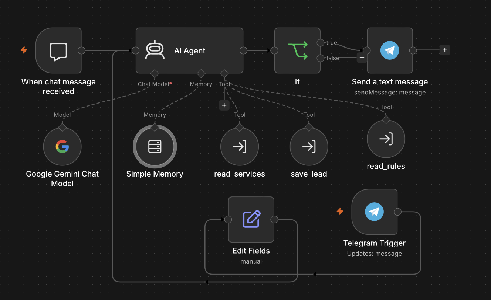

# Lead Qualification Agent (n8n + Gemini + Telegram)

An AI agent that qualifies incoming sales leads. A client writes a free-text
request in Telegram; the agent extracts the key details, asks for anything
missing, classifies the lead by documented rules, and saves complete leads to
Google Sheets.

The focus of this project is **testing an AI agent**: 10 scenario tests,
a failure log with root causes and fixes, and screenshots of each result.



## What it does

| Step | How |
|---|---|
| Receive a request | Telegram Trigger (or the n8n chat panel for local tests) |
| Understand it | AI Agent on Google Gemini, with per-chat memory |
| Check the facts | Tools that read services and qualification rules from Google Sheets |
| Decide | `hot`, `warm`, `cold` or `incomplete`, by the rules in `data/` |
| Record | Saves complete leads to Google Sheets; asks a follow-up question otherwise |

## Testing

All scenarios, inputs, expected and actual results are in
[`docs/test-report.md`](docs/test-report.md). Examples:

| Test | Scenario | Result |
|---|---|---|
| T01 | Complete valid request | Lead saved, correct qualification |
| T02 | Budget missing | Not saved; agent asks for the budget (bug found and fixed) |
| T03 | Service the agency does not offer | Polite decline, lead marked `cold` |
| T04 | Contradictory budget and deadline | Agent asks to clarify, nothing saved |
| T08 | Tools disconnected | Empty answer found; documented as a known gap |
| T09 | Malformed tool input | Rejected by validation instead of written to the sheet |

Found defects and how they were fixed: [`docs/failure-log.md`](docs/failure-log.md).
Prompt versions and why they changed: [`docs/prompt-log.md`](docs/prompt-log.md).
Requirements and acceptance criteria: [`docs/discovery.md`](docs/discovery.md).

## Tech stack

n8n (Docker) · Google Gemini · Telegram Bot API · Google Sheets · ngrok

## Run it locally

You need Docker, a Telegram bot token, a Gemini API key, a Google OAuth client
for Sheets, and an ngrok account with a static domain.

1. Create `.env` next to `docker-compose.yaml`:
   ```
   TIMEZONE=UTC
   URL=https://<your-ngrok-domain>
   NGROK_TOKEN=<your-ngrok-authtoken>
   ```
2. Put your ngrok domain into `ngrok.yml`.
3. Start: `docker compose up -d`, then open `http://localhost:5678`.
4. In n8n add three credentials: Gemini, Google Sheets, Telegram.
5. Create a Google Sheet from the CSV files in `data/` (one tab per file).
6. Import the four workflows from `workflows/`, set your sheet ID in the
   Google Sheets nodes, publish the three tool workflows, then the main one.

## Known limitations

- `Simple Memory` keeps conversations inside one n8n instance. A scaled
  deployment would need an external store (Redis or Postgres).
- With all tools unavailable the agent returns an empty reply (T08). A
  production version needs an explicit fallback message.
- One Telegram bot token can be connected to one n8n instance at a time.

## Data and security

- All data is synthetic; emails use the reserved `.example` domain.
- Workflow files contain no keys or tokens: n8n stores credentials separately
  and the export only references them by name.
- Secrets live in `.env`, which is excluded from git.
